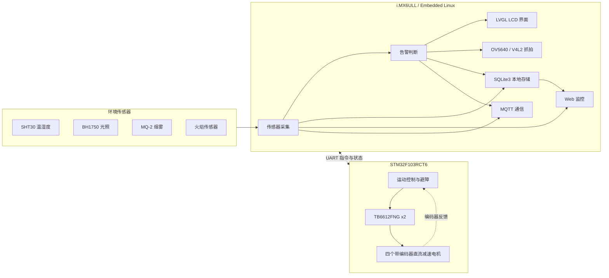

# ARM Linux Master-Slave Inspection System

基于 i.MX6ULL 与 STM32 的消防巡检机器人系统，面向仓库、机房、配电房等需要日常巡检的场景。系统由环境感知、告警联动、现场显示、数据管理和移动底盘组成：i.MX6ULL 负责 Linux 应用与设备管理，STM32 负责底盘实时控制，两端通过 UART 交换指令和状态。

## 项目架构

## 主要功能

- 采集 SHT30 温湿度、BH1750 光照、MQ-2 烟雾模拟量和火焰状态，并对数据进行换算、有效性检查和阈值判断。
- 检测到异常后生成告警事件，更新 LCD 告警日志，触发 OV5640 摄像头预热与抓拍，并保存告警数据和图片路径。
- 使用 SQLite3 保存传感器历史数据和告警记录；通过 Web 页面查看实时数据、历史记录、告警详情及抓拍图片。
- 通过 MQTT 发布环境数据和告警消息，支持远程监控。
- STM32F103RCT6 控制四轮差速底盘，通过编码器反馈和 PID 调速完成运动控制，并承担巡航与避障逻辑。
- i.MX6ULL 通过 UART 向 STM32 下发运动指令并接收状态响应。

## 软件设计

i.MX6ULL 应用采用 pthread 多线程架构，将传感器采集、告警判断、数据库存储、界面刷新和 MQTT 通信拆分为独立任务。模块间通过线程邮箱传递传感器数据和告警事件；告警线程负责形成事件，摄像头、数据库、UI 和网络模块分别处理各自的工作。LVGL 界面由专属线程更新，避免采集和告警任务直接操作 UI 对象。

STM32 侧负责实时性要求较高的底盘控制。上层巡检逻辑通过 UART 发送控制指令，STM32 根据编码器速度反馈调节电机 PWM，并处理巡航、避障和运动状态反馈。

## 技术栈

`Embedded Linux` · `C` · `i.MX6ULL` · `STM32F103RCT6` · `pthread` · `线程邮箱` · `I2C` · `GPIO` · `IIO/ADC` · `UART` · `PWM/PID` · `V4L2` · `OV5640` · `LVGL` · `GUI Guider` · `SQLite3` · `Web` · `MQTT` · `TB6612FNG`

## 项目分工

项目由两人协作完成。i.MX6ULL 端负责 Linux 系统与设备适配、传感器采集、告警联动、LCD 界面、摄像头、数据存储和网络通信；STM32 端负责电机驱动、编码器测速、PID 调速、底盘巡航与避障，并通过 UART 和 i.MX6ULL 协同工作。
